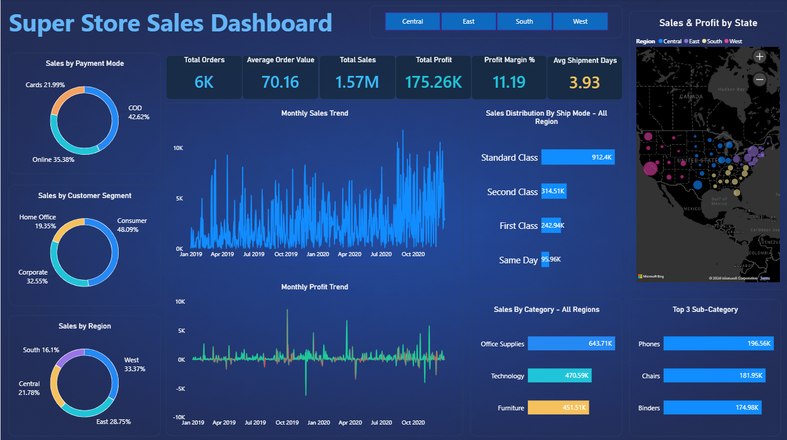
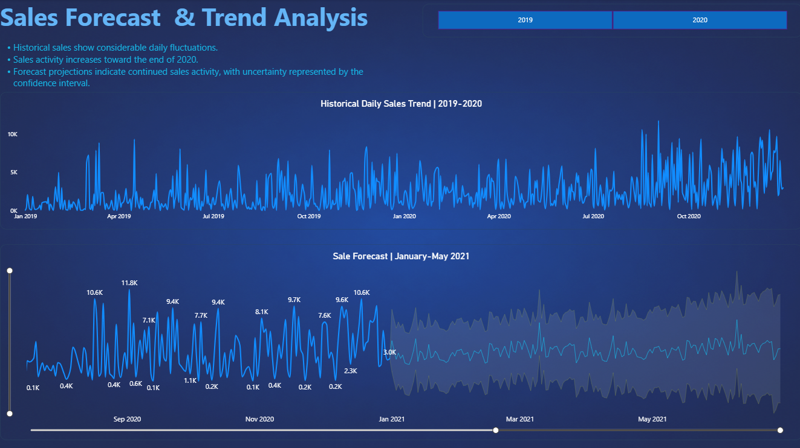

# Super Store Sales Analysis | Power BI

An interactive business intelligence project built using Microsoft Power BI to analyze retail sales performance, profitability, customer segments, regional distribution and sales forecasting.

## Project Overview

This project explores a Superstore retail dataset to identify business trends, understand profitability across product categories, evaluate customer purchasing patterns and generate actionable business insights.

The dashboard transforms raw sales data into interactive visualizations and performance indicators to support data-driven decision-making.

## Dashboard Preview

### 1. Sales Overview Dashboard

### 2. Sales Forecast Dashboard

### 3. Category Profitability Analysis

### 1. Sales Overview

The main dashboard provides an overview of business performance through:

- Total Sales
- Total Profit
- Total Orders
- Average Order Value
- Profit Margin
- Average Shipping Days
- Sales by Payment Mode
- Sales by Customer Segment
- Regional Sales Distribution
- Monthly Sales Trends
- Sales by Shipping Mode
- Sales by Product Category and Sub-Category

### 2. Sales Forecasting

Explores historical sales patterns and future sales projections to understand potential business performance.

### 3. Category Profitability Analysis

A scatterplot-based analysis comparing sales and profit across the three major product categories:

- Technology
- Office Supplies
- Furniture

The analysis helps identify high-performing categories and areas requiring profitability improvement.

## Key Business Insights

- Total sales reached approximately $1.57 million.
- Total profit was approximately $175.26K.
- Overall profit margin was 11.19%.
- Office Supplies generated the highest sales among the three product categories.
- Technology generated the highest category-level profit.
- Furniture demonstrated comparatively lower profitability and requires further investigation.

## Tools & Technologies

- Microsoft Power BI
- Power Query
- DAX (Data Analysis Expressions)
- Data Visualization
- Data Cleaning and Transformation
- Business Intelligence
- Exploratory Data Analysis

## Key Skills Demonstrated

- Data preparation and transformation
- KPI development using DAX
- Interactive dashboard design
- Time-series sales analysis
- Profitability analysis
- Comparative business analysis
- Data storytelling

## Project Files

| File | Description |
|---|---|
| `.pbix` | Power BI dashboard source file |
| `screenshots/` | Dashboard screenshots |
| `dataset/` | Source dataset, where redistribution is permitted |

## Conclusion

This project demonstrates how Power BI can be used to transform retail transaction data into meaningful business intelligence.

The analysis highlights sales performance, profitability differences, customer segments and potential areas for business improvement.

---

**Author:** Rik Pramanik

**LinkedIn:** https://www.linkedin.com/in/rik-pramanik-data/
